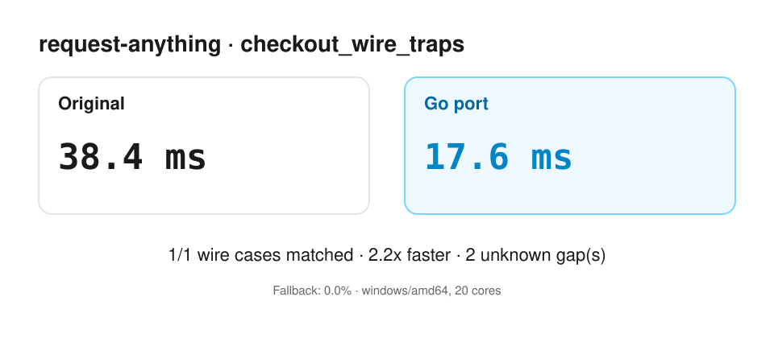
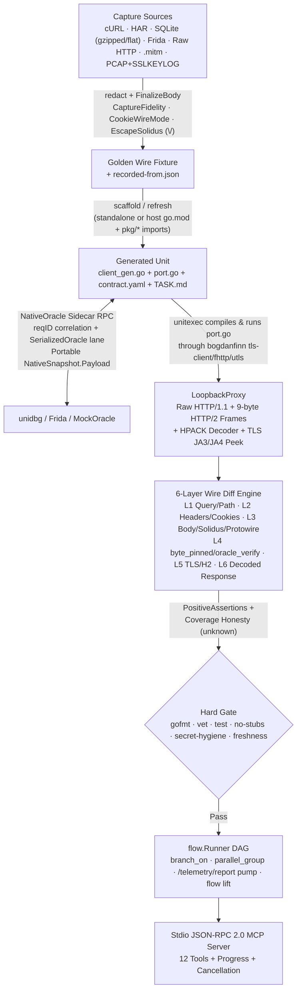

# `request-anything`

**English** | [Tiếng Việt](README.vi.md)

Port HTTP/1.1, HTTP/2, and Protobuf API requests — plus stateful multi-step mobile and web flows — to Go with **Wire-Level Ground Truth**, **NativeOracle session correlation**, and **zero false-green Hard Gates**.

Built on [`bogdanfinn/tls-client`](https://github.com/bogdanfinn/tls-client) + [`bogdanfinn/fhttp`](https://github.com/bogdanfinn/fhttp) + [`bogdanfinn/utls`](https://github.com/bogdanfinn/utls), `request-anything` lets AI coding agents (Claude Code, Codex, Cursor, Gemini CLI, OpenCode, Antigravity, Kimi) write and iterate on Go request code (`port.go`) while checking every transmitted byte through a raw loopback wire proxy.



---

## Try It in 10 Seconds (`examples/wire-traps`)

The [`examples/wire-traps`](examples/wire-traps) showcase compares a real raw HTTP baseline ([`capture.http`](examples/wire-traps/capture.http)) against a naive `net/http` + `url.Values.Encode()` + `encoding/json` port ([`naive_broken.http`](examples/wire-traps/naive_broken.http)):

```bash
# 1. Watch 6-layer diff catch all 8 silent wire divergences from naive net/http:
request-anything diff ./examples/wire-traps/unit --actual ./examples/wire-traps/naive_broken/post_v2_checkout.fixture.json
```

```text
L1  query.trailing_amp       trailing `&` dropped (expected true, got false)
L1  query[1].resolution      1080*2400 -> 1080%2A2400 (url.Values.Encode mangled '*')
L2  headers[1].x-client-ver  lowercase "x-client-ver" -> "X-Client-Ver"
L2  headers[2].content-md5   lowercase "content-md5" -> "Content-Md5"
L2  headers[4].Content-Length 68 -> 63 bytes
L3  body.json.escape_solidus missing Android `\/` solidus escaping
L3  body.json.amount         raw lexeme 19.0 collapsed to 19
L4  header.content-md5       Content-Md5 digest mismatch on mutated JSON body
summary: FAIL (8 mismatch(es), 2 unknown(s))
```

```bash
# 2. Verify the generated wireclient port compiles, executes live via LoopbackProxy, and passes Hard Gate:
request-anything gate ./examples/wire-traps/unit
# -> passed: true (11/11 checks green, 1/1 wire case matched)
```

---

## Architecture Flow



---

## Why `request-anything` (Go) Instead of Blind LLM Request Porting

| Subtle Wire Trap | How `request-anything` Stops It |
| :--- | :--- |
| Go `http.Header` / `url.Values` mangling | [`pkg/wireclient`](pkg/wireclient) preserves exact header casing (`ForceHTTP1Raw`), H2 pseudo-header ordering, `*` (`1216*2623`), `?iid=` (`HasEq`), trailing `&`, and strips auto-injected `Go-http-client` `User-Agent`. |
| Cronet HTTP/2 separate `cookie:` crumbs | `CookieWireMode` distinguishes `h2_crumbs` vs `single_header`; L2 diffs individual cookie crumb names, order, and values. |
| Android `JSONObject` solidus escaping (`\/`) | `ordered_json.go` toggles `EscapeSolidus: true` and preserves raw `json.Number` lexemes (`3` vs `3.0`) so body MD5 digests and `Content-Length` match byte-for-byte. |
| Dual-fail false greens (`HTTP 200` + `error_code=7`) | `contract.yaml` enforces `positive_assertions` (`non_empty_field`, `status_in`, `json_path_eq`, `zero_native_exceptions`, `req_id_correlation`). |
| Native `.so` state & FIFO queue corruption | `pkg/oracle.SerializedOracle` serializes access per `SessionHandle`, correlates `DeliverResponse(reqID, resp)`, pumps async `/telemetry/report` packets, and persists portable `NativeSnapshot.Payload`. |
| `lossy_har` or unobserved wire layers | **Coverage Honesty** explicitly surfaces `unknown` items (`HPACK`, `QPACK`, `lossy_har` transport) rather than reporting fake 100% parity. |
| Self-comparison / silent-pass traps | `diff`, `gate`, `fuzz`, and `report` compile (`go test -c`) and execute `port.go` live against `LoopbackProxy`. |

---

## Installation & Agent Setup

### Option 1: Prebuilt Binaries (Recommended)
Download prebuilt archives for **Windows / macOS / Linux (`amd64` & `arm64`)** from [GitHub Releases](https://github.com/TaTrap/request-anything/releases), extract onto your `PATH`, and run:

```bash
request-anything setup     # Registers MCP server & skills cleanly with backups
request-anything doctor    # Verifies Go toolchain, local ECDSA CA, and MCP self-test
```

### Option 2: Build from Source (`Go 1.24+`)
Tested on `go1.27.4` Windows/Linux:

```bash
go install github.com/TaTrap/request-anything/cmd/request-anything@latest
request-anything setup
request-anything doctor
```

---

## Quickstart

```bash
# 1. Import a capture into redacted Golden Fixtures
request-anything import capture.sqlite3 --out ./fixtures

# 2. Scaffold a Go unit (auto-wires standalone go.mod or host project go.mod)
request-anything scaffold ./fixtures/device_register.fixture.json --out ./ports/device_register

# 3. Edit ONLY ./ports/device_register/port.go, then diff & gate
request-anything diff ./ports/device_register
request-anything gate ./ports/device_register

# 4. Multi-step stateful flow replay & fallback-free lift
request-anything flow replay ./flows/onboarding
request-anything flow lift   ./flows/onboarding

# 5. Benchmark Go port & generate REPORT.md + card.svg
request-anything report ./ports/device_register
request-anything map . --write --check
```

---

## CLI & MCP Tool Surface

- **CLI Commands:** `import`, `analyze`, `scaffold`, `refresh`, `diff`, `gate`, `capture`, `flow replay`, `flow lift`, `fuzz`, `shadow`, `report`, `map`, `go`, `mcp`, `setup`, `doctor`.
- **MCP Stdio Server (`request-anything mcp`):** JSON-RPC 2.0 over stdin/stdout with exclusive writer goroutine, cancellation (`notifications/cancelled`), progress notifications, structured error classifier, embedded prompts (`port_request`, `port_flow`), and 12 tools (`import`, `scaffold`, `diff`, `gate`, `flow_replay`, `analyze`, `refresh`, `fuzz`, `shadow`, `report`, `map`, `go`).

---

## Repository Layout

- `cmd/request-anything/` — Cobra CLI entry point
- `examples/wire-traps/` — 10-second runnable showcase contrasting naive `net/http` vs `wireclient`
- `pkg/models/` — Public lossless wire, contract, diff, gate, and manifest types
- `pkg/wireclient/` — Unified `tls-client` + `fhttp` + `utls` wire client, ordered JSON/query/headers, gzip/br/zstd/deflate codecs
- `pkg/oracle/` — `NativeOracle`, `SerializedOracle`, `RPCClient`, `MockOracle`, `VerifySignatureRule`
- `pkg/diff/` — Public wrapper over the 6-layer wire diff & schema-less `protowire` comparator
- `internal/` — Ingest (`curl`, `har`, `raw_http`, `frida`, `sqlite` gzipped/flat, `.mitm`, `tshark` PCAP JSON), `capture` (`LoopbackProxy` raw H1/H2/TLS), `unitexec`, `gate`, `flow`, `fuzz`, `shadow`, `report`, `mcp`, `redact`, `scaffold`
- `skills/request-anything/` — Embedded agent playbooks (`SKILL.md`, `whole-flow.md`)
- `tests/` — E2E verification across all vertical slices, mandatory regressions, out-of-repo standalone/host-module compilation, and repo hygiene

---

## License & Acknowledgments

- Licensed under the [MIT License](LICENSE).
- Inspired by [`erkamyaman/rust-anything`](https://github.com/erkamyaman/rust-anything).
