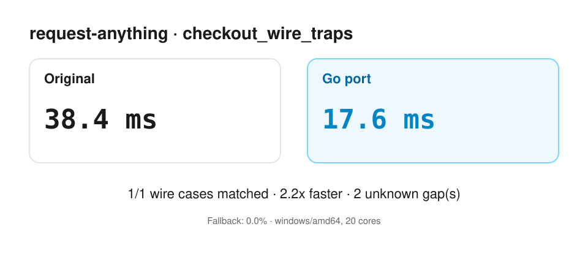
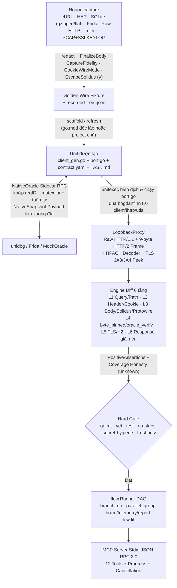

# `request-anything`

**Tiếng Việt** | [English](README.md)

Port các API request HTTP/1.1, HTTP/2, Protobuf — cùng các luồng session nhiều bước (multi-step stateful flows) trên mobile và web — sang Go với cơ chế **Wire-Level Ground Truth**, tương quan session qua **`NativeOracle`**, và cổng kiểm định **Hard Gate** chống pass giả.

Xây dựng đồng bộ trên [`bogdanfinn/tls-client`](https://github.com/bogdanfinn/tls-client) + [`bogdanfinn/fhttp`](https://github.com/bogdanfinn/fhttp) + [`bogdanfinn/utls`](https://github.com/bogdanfinn/utls), `request-anything` giúp các AI coding agent (Claude Code, Codex, Cursor, Gemini CLI, OpenCode, Antigravity, Kimi) tự viết và tinh chỉnh mã Go (`port.go`) trong khi mọi byte phát ra đều được soi trực tiếp qua một loopback wire proxy.



---

## Chạy thử trong 10 giây (`examples/wire-traps`)

Thư mục mẫu [`examples/wire-traps`](examples/wire-traps) đối chiếu trực tiếp một bản ghi raw HTTP chuẩn ([`capture.http`](examples/wire-traps/capture.http)) với một request port ngây thơ bằng `net/http` + `url.Values.Encode()` + `encoding/json` ([`naive_broken.http`](examples/wire-traps/naive_broken.http)):

```bash
# 1. Chạy 6-layer diff để bắt toàn bộ 8 lỗi sai lệch dây mạng từ net/http:
request-anything diff ./examples/wire-traps/unit --actual ./examples/wire-traps/naive_broken/post_v2_checkout.fixture.json
```

```text
L1  query.trailing_amp       trailing `&` bị cắt mất (expected true, got false)
L1  query[1].resolution      1080*2400 -> 1080%2A2400 (url.Values.Encode mã hoá sai dấu '*')
L2  headers[1].x-client-ver  chữ thường "x-client-ver" bị ép thành "X-Client-Ver"
L2  headers[2].content-md5   chữ thường "content-md5" bị ép thành "Content-Md5"
L2  headers[4].Content-Length lệch byte 68 -> 63
L3  body.json.escape_solidus thiếu kiểu escape `\/` của Android
L3  body.json.amount         raw lexeme 19.0 bị rút gọn thành 19
L4  header.content-md5       sai lệch digest Content-Md5 trên JSON body bị biến dạng
summary: FAIL (8 mismatch(es), 2 unknown(s))
```

```bash
# 2. Biên dịch, chạy port.go thật qua LoopbackProxy và kiểm định Hard Gate:
request-anything gate ./examples/wire-traps/unit
# -> passed: true (11/11 checks đạt, 1/1 wire case khớp)
```

---

## Luồng kiến trúc



---

## Vì sao dùng `request-anything` (Go) thay vì nhờ LLM port chay?

| Cái bẫy trên dây mạng | Cách `request-anything` xử lý |
| :--- | :--- |
| Go `http.Header` / `url.Values` tự biến đổi | [`pkg/wireclient`](pkg/wireclient) giữ nguyên hoa-thường header (`ForceHTTP1Raw`), thứ tự pseudo-header HTTP/2, ký tự `*` (`1216*2623`), `?iid=` (`HasEq`), dấu `&` cuối URL và loại bỏ `User-Agent` `Go-http-client` tự chèn. |
| Cronet HTTP/2 tách rời từng header `cookie:` | `CookieWireMode` phân biệt `h2_crumbs` và `single_header`; tầng L2 đối chiếu từng tên, thứ tự và giá trị cookie crumb thay vì chỉ đếm số lượng. |
| Kiểu escape dấu `/` thành `\/` của Android `JSONObject` | `ordered_json.go` bật cờ `EscapeSolidus: true` và bảo toàn định dạng số thô `json.Number` (`3` khác `3.0`) để digest MD5 của body và `Content-Length` khớp từng byte. |
| Pass giả hai lớp (`HTTP 200` nhưng `error_code=7`) | `contract.yaml` ép chạy `positive_assertions` (`non_empty_field`, `status_in`, `json_path_eq`, `zero_native_exceptions`, `req_id_correlation`). |
| Trạng thái `.so` native & lỗi lệch hàng đợi FIFO | `pkg/oracle.SerializedOracle` khoá tuần tự từng `SessionHandle`, đối chiếu chính xác `DeliverResponse(reqID, resp)`, bơm gói async `/telemetry/report` và xuất `NativeSnapshot.Payload` ra đĩa. |
| Nguồn `lossy_har` hoặc tầng transport không quan sát được | Cơ chế **Coverage Honesty** báo cáo minh bạch các mục `unknown` (`HPACK`, `QPACK`, thiếu metadata `lossy_har`) thay vì báo pass ảo 100%. |
| So sánh tự chiếu hoặc test không chạy code thật | `diff`, `gate`, `fuzz` và `report` đều biên dịch (`go test -c`) và chạy sống `port.go` qua `LoopbackProxy`. |

---

## Cài đặt & Thiết lập cho AI Agent

### Cách 1: Tải binary dựng sẵn (Khuyên dùng)
Tải bản build cho **Windows / macOS / Linux (`amd64` & `arm64`)** tại [GitHub Releases](https://github.com/TaTrap/request-anything/releases), giải nén vào thư mục thuộc `PATH` của bạn rồi chạy:

```bash
request-anything setup     # Tự động cấu hình MCP server & skill kèm file backup
request-anything doctor    # Kiểm tra Go toolchain, local ECDSA CA và self-test MCP
```

### Cách 2: Cài từ mã nguồn (`Go 1.24+`)
Đã kiểm chứng trên `go1.27.4` Windows/Linux:

```bash
go install github.com/TaTrap/request-anything/cmd/request-anything@latest
request-anything setup
request-anything doctor
```

---

## Bắt đầu nhanh (Quickstart)

```bash
# 1. Import capture thành Golden Fixture đã redact secret
request-anything import capture.sqlite3 --out ./fixtures

# 2. Scaffold Go unit (tự nối go.mod độc lập hoặc go.mod của project chủ)
request-anything scaffold ./fixtures/device_register.fixture.json --out ./ports/device_register

# 3. Chỉ sửa ./ports/device_register/port.go, sau đó chạy diff & gate
request-anything diff ./ports/device_register
request-anything gate ./ports/device_register

# 4. Chạy lại flow nhiều bước và lift khi fallback = 0%
request-anything flow replay ./flows/onboarding
request-anything flow lift   ./flows/onboarding

# 5. Benchmark bản Go port và xuất REPORT.md + card.svg
request-anything report ./ports/device_register
request-anything map . --write --check
```

---

## Bề mặt lệnh CLI & MCP Server

- **Các lệnh CLI:** `import`, `analyze`, `scaffold`, `refresh`, `diff`, `gate`, `capture`, `flow replay`, `flow lift`, `fuzz`, `shadow`, `report`, `map`, `go`, `mcp`, `setup`, `doctor`.
- **MCP Stdio Server (`request-anything mcp`):** Giao tiếp JSON-RPC 2.0 qua stdin/stdout với goroutine ghi độc quyền, hỗ trợ huỷ tác vụ (`notifications/cancelled`), thông báo tiến độ, phân loại lỗi có cấu trúc, prompt nhúng sẵn (`port_request`, `port_flow`) và 12 tool (`import`, `scaffold`, `diff`, `gate`, `flow_replay`, `analyze`, `refresh`, `fuzz`, `shadow`, `report`, `map`, `go`).

---

## Cấu trúc thư mục

- `cmd/request-anything/` — Điểm khởi chạy CLI (Cobra)
- `examples/wire-traps/` — Bộ ví dụ chạy trong 10 giây đối chiếu `net/http` và `wireclient`
- `pkg/models/` — Định nghĩa schema dữ liệu dây mạng, `contract.yaml`, kết quả diff, gate và manifest
- `pkg/wireclient/` — Client thống nhất `tls-client` + `fhttp` + `utls`, JSON/query/header giữ nguyên thứ tự và codec nén `gzip`/`br`/`zstd`/`deflate`
- `pkg/oracle/` — Interface `NativeOracle`, `SerializedOracle`, `RPCClient`, `MockOracle`, và `VerifySignatureRule`
- `pkg/diff/` — API public bọc engine diff 6 tầng và bộ so sánh Protobuf không cần schema (`protowire`)
- `internal/` — Bộ import (`curl`, `har`, `raw_http`, `frida`, `sqlite` gzipped/flat, `.mitm`, `tshark` PCAP JSON), `capture` (`LoopbackProxy` raw H1/H2/TLS), `unitexec`, `gate`, `flow`, `fuzz`, `shadow`, `report`, `mcp`, `redact`, `scaffold`
- `skills/request-anything/` — Playbook hướng dẫn AI Agent nhúng sẵn (`SKILL.md`, `whole-flow.md`)
- `tests/` — Kiểm thử E2E xuyên suốt các vertical slice, bộ regression bắt buộc, compile ngoài repo và kiểm tra vệ sinh secret

---

## Giấy phép & Ghi nhận

- Phát hành theo [Giấy phép MIT](LICENSE).
- Lấy cảm hứng từ dự án [`erkamyaman/rust-anything`](https://github.com/erkamyaman/rust-anything).
