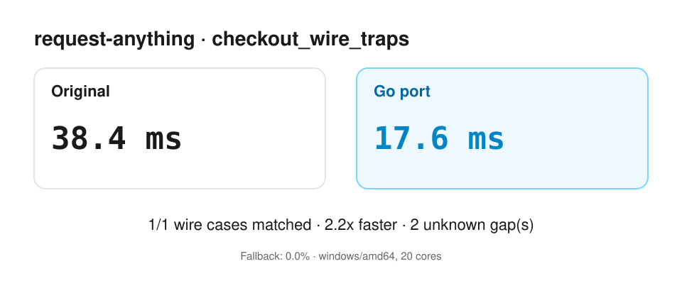

## checkout_wire_traps in Go (`request-anything`)

| Metric | Value |
| --- | --- |
| Wire cases matched | 1 / 1 |
| Original p50 | 38.40 ms |
| Go port p50 | 17.61 ms (2.2x) |
| Fallback rate | 0.0% |
| Coverage Honesty (unknown) | 2 declared gap(s) |
| Machine | windows/amd64, 20 cores |
